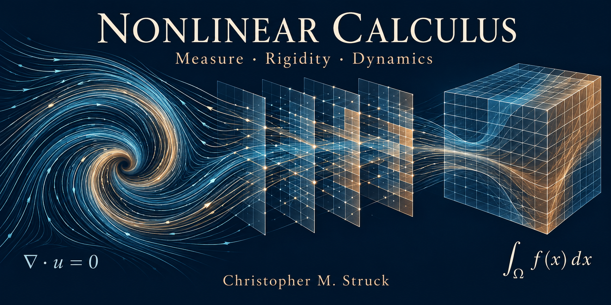

# Integrations in Nonlinear Calculus and 3D Navier–Stokes: Research and Applications

*Christopher M. Struck's preprints on the Matrix of Error, Lebesgue measure, rigidity, fluid dynamics, relativity, and quantum foundations.*

**Author:** [Christopher M. Struck](https://orcid.org/0009-0009-4291-6782)

How can an integration method connect binary probability, nonlinear fluid dynamics, gravitational density, and the mechanics of interacting bodies?

My research examines these connections through nonlinear calculus and the Matrix of Error: a framework for identifying, retaining, and calculating physical contributions that a simpler description may omit. The methodology develops exact integral identities, closed-form results for specified systems, and explicit dynamical envelopes. Navier–Stokes provides a demanding stepping stone: the rigidity analysis develops its integrated balance into equality, stability, and threshold results. Richer physical models can become more tractable when their specified time dependence and constraints supply the structure needed to close and evaluate those calculations.

The research develops through nine connected papers. The earlier studies establish the probability, integration, fluid-dynamics, and relativistic foundations. Paper 8 brings those studies together as a practical methods guide. Paper 9 applies and develops the methods through rigidity, the Navier–Stokes envelope, solid deformation, and multibody dynamics.

This repository provides an overview of the connections and direct links to the Zenodo preprints. The papers folder and index provides the same detail that can be found on Zenodo.

## Paper Index

| Paper | Research focus | Zenodo DOI |
| --- | --- | --- |
| 1 | Binary symmetry and Lebesgue measure | [10.5281/zenodo.21705119](https://doi.org/10.5281/zenodo.21705119) |
| 2 | Binary measure, half-frequency, and spectral statistics | [10.5281/zenodo.22165136](https://doi.org/10.5281/zenodo.22165136) |
| 3 | Definite outcomes and observation convergence | [10.5281/zenodo.22165280](https://doi.org/10.5281/zenodo.22165280) |
| 4 | Nonlinear calculus and three-dimensional Navier–Stokes | [10.5281/zenodo.22432312](https://doi.org/10.5281/zenodo.22432312) |
| 5 | Navier–Stokes continuation and forced breakdown | [10.5281/zenodo.22680119](https://doi.org/10.5281/zenodo.22680119) |
| 6 | Gravitational density and physical correspondence | [10.5281/zenodo.22682488](https://doi.org/10.5281/zenodo.22682488) |
| 7 | Relativity and the interpretation behind the methods | [10.5281/zenodo.22682490](https://doi.org/10.5281/zenodo.22682490) |
| 8 | Methods bridge across Papers 1–7 | [10.5281/zenodo.23343429](https://doi.org/10.5281/zenodo.23343429) |
| 9 | Rigidity, Lebesgue integration, and worked applications | [10.5281/zenodo.23671648](https://doi.org/10.5281/zenodo.23671648) |

## The Matrix of Error and Nonlinear Integration

In the Matrix-of-Error framework, "error" can represent a recoverable physical contribution - the difference between a nominal description and a fuller account of the system.

That distinction matters. An omitted interaction may appear as a discrepancy in a prediction or become absorbed into an estimated parameter. Retaining its contribution explicitly makes it possible to investigate what produced the difference.

The working process involves stating the governing relationships, performing the relevant integrations, assembling signed contribution terms, and checking the completed balance.

Integration by parts plays a central role. It transfers derivatives onto chosen test functions while preserving the boundary conditions and physical terms needed to interpret the result.

The shared procedure connects the applications, while each system retains its own governing equations and assumptions.

## The Research Papers

### Paper 1: Binary Symmetry, Probability, and Lebesgue Measure

**[The Bare Binary Biconditional: Its Quantum-Calculus Correspondence and Implications for the Equal-Weight Envariance Gap](https://doi.org/10.5281/zenodo.21705119)**

This foundational paper connects binary exchange symmetry, half-probability, asymptotic frequency, and integration.

Within the stated independent Bernoulli setting, fair infinite binary records map to Lebesgue measure on the unit interval. This provides an explicit correspondence between probability on binary records and a familiar foundation of calculus.

The paper also examines the relationship to symmetric binary quantum measurement.

### Paper 2: Binary Measure, Half-Frequency, and Spectral Statistics

**[Binary Measure, Arithmetic Half-Frequency, and Spectral Statistics: Finite Dyadic Pushforwards, Deterministic Sign Records, and Zeta-Zero Comparisons](https://doi.org/10.5281/zenodo.22165136)**

The computational companion develops three related investigations: finite dyadic representations of measure, deterministic arithmetic sign records, and spectral-statistics comparisons involving zeta zeros.

It distinguishes exact finite measure identities from asymptotic frequency statements and numerical comparisons.

### Paper 3: Definite Outcomes and Observation Convergence

**[Definite Outcomes at Infinity: The Bare Binary Biconditional, Repeated QND Measurement, and the Quantum Convergence Conjecture](https://doi.org/10.5281/zenodo.22165280)**

This paper examines how accumulating observations can drive conditional probability weights toward definite binary endpoints under stated identifiability conditions.

It connects the classical observation model to repeated quantum nondemolition measurement, separating the established convergence results from the remaining quantum-convergence conjecture.

### Paper 4: Nonlinear Calculus and Three-Dimensional Navier–Stokes

**[Nonlinear Calculus and Solving Three-Dimensional Navier–Stokes: Cross-System Derivation, Universal Matrix of Error, and Coordinate-Robust Validation](https://doi.org/10.5281/zenodo.22432312)**

This paper develops the shared integration and Matrix-of-Error framework through orbital motion, Burgers' equation, and two- and three-dimensional fluid systems.

Its three-dimensional Navier–Stokes treatment includes an explicit vorticity contribution matrix, the exact enstrophy balance, coordinate checks, and numerical flow examples.

The analysis connects that representation to a conditional smooth-continuation estimate. The conditions supporting continuation remain an essential part of the result.

### Paper 5: Navier–Stokes Continuation and Forced Breakdown

**[Two-Component Continuation Control in Navier–Stokes: The Matrix-of-Error Framework and Smoothly Forced Breakdown](https://doi.org/10.5281/zenodo.22680119)**

This companion paper concentrates on the continuation condition and its relationship to smoothly forced dynamics.

It explains the analytical control quantity, how forcing enters the envelope, and what a reported finite-time breakdown implies for the relevant accumulated control integral.

The comparison clarifies the distinction between a conditional continuation theorem and establishing its hypotheses across an entire solution class.

### Paper 6: Gravitational Density and Physical Correspondence

**[Gravitational Density: Massive States, Mimetic Matter, and Vacuum Stress](https://doi.org/10.5281/zenodo.22682488)**

This study compares massive-state populations, mimetic matter, and vacuum stress through a common conservation description.

It calculates when descriptions can share an effective density or stress tensor, retaining pressure and energy exchange explicitly. A propagation extension connects a specified density model to its metric response and a light-travel-delay calculation.

The comparison distinguishes matching mathematical behavior from identifying its underlying physical origin.

### Paper 7: The Relativistic Interpretation Behind the Methods

**[Extended Relativity: Space, Time, and the Interpretation Behind Nonlinear Calculus](https://doi.org/10.5281/zenodo.22682490)**

This paper explains the interconnected spacetime interpretation that motivated the Matrix-of-Error program.

It relates mass, motion, gravity, light propagation, and temporal relationships to the completed calculations. Its role is to connect the physical motivation with the mathematical work while distinguishing interpretation from a demonstrated mechanism.

### Paper 8: The Bridge Connecting the Earlier Work

**[Nonlinear Calculus in Practice: The Matrix of Error and Cross-System Integration](https://doi.org/10.5281/zenodo.23343429)**

**Paper 8 is the practical bridge across the first seven papers.**

It explains the steps between stating a result and carrying out its calculation: choosing weak measurements, integrating by parts, retaining signed contributions, assembling matrices, recovering coefficients, and interpreting the completed balance.

A worked Burgers calculation introduces the procedure. The discussion then develops the three-dimensional Navier–Stokes vorticity features, full matrix contraction, exact enstrophy balance, and continuation envelope.

The paper also explains the connections to binary probability, observation convergence, gravitational density, and relativity through their actual calculations and motivating relationships.

For a reader entering the research program, this is the methods guide.

### Paper 9: Lebesgue Measure, Rigidity, and Worked Applications

**[Nonlinear Calculus in Practice 2: Rigidity, Lebesgue, Solid Deformation, and Multibody Dynamics](https://doi.org/10.5281/zenodo.23671648)**

**Paper 9 applies and develops the methods explained in Paper 8.**

One central connection runs from Lebesgue integration to rigidity, and from rigidity to the weighted budget underlying the Navier–Stokes envelope.

A useful principle connects these calculations: when a nonnegative quantity has zero integral, it vanishes almost everywhere. Combined with the appropriate balance laws or geometric compatibility conditions, this identifies the configurations that can attain equality.

For the periodic viscous-flow case examined in the paper, the weighted budget identifies an equality condition that forces a spatially constant flow. Quantitative estimates then control accumulated departure and provide threshold conclusions under stated decay assumptions.

Solid deformation supplies a separate geometric application. Integrated departure from local rotations controls departure from one common rigid motion. The paper works through an explicit volume-preserving deformation to demonstrate the calculation.

The applications include an analytically integrated, volume-preserving warping map and a separate seven-block stress formulation coupling solid motion, internal strain, and heat. Worked gravitational and articulated five-body examples show how omitted physical structure can alter inferred parameters. In a controlled, noise-free gravity comparison, replacing resolved body volumes with point centers shifts fitted masses by up to 3.205%, without improving predictions over the wider held-out configuration range. A second-moment correction reduces the maximum mass bias to 0.236%, while the full resolved-volume model recovers the known masses near the observed numerical resolution. These examples extend the shared integration methodology while making the consequences of omitted contributions measurable. The central result is the fully resolved matrix, which closes the complete physical balance and recovers the known parameters with no error beyond the observed numerical resolution.

The progression is therefore concrete: a shared integration foundation, precise rigidity conditions, dynamical envelopes, and worked physical applications.

## AI-Assisted Exploration and Mathematical Checking

AI tools support the exploration of candidate derivations, symbolic relationships, and computational implementations.

The mathematical work remains in the explicit assumptions, traceable calculations, boundary treatment, and checks against reference results.

Throughout the series, analytical identities, numerical examples, conditional results, and physical interpretations have distinct roles. Making those roles visible helps readers assess and reproduce the work.

## Where to Begin

Start with Paper 8 for the practical method and its connections across the earlier research. Continue to Paper 9 for the mathematical developments and worked applications.

For the original three-dimensional fluid treatment, read Paper 4, followed by Paper 5 on continuation control.

Papers 1–3 develop the probability-and-measure foundations. Papers 6–7 develop the gravitational-density comparison and its relativistic interpretation.

**Christopher M. Struck**

Independent researcher working on nonlinear calculus, the Matrix of Error, fluid dynamics, relativity, and quantum foundations.

[ORCID: 0009-0009-4291-6782](https://orcid.org/0009-0009-4291-6782)
